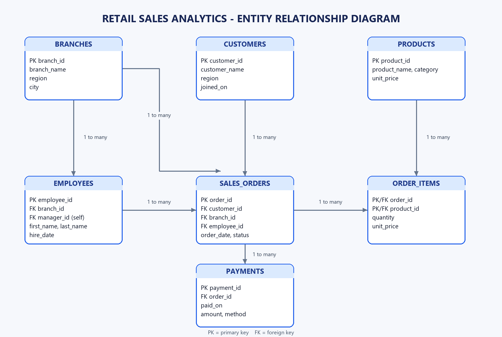

# ULK SQL Database — Amar-Assignment-VI

## Student
- Name: Amar Ahmed Alduom
- Department: Data Sciences
- Roll number: 202512897
- Individual: Amar Ahmed Ahmed

> The assignment asks for groups of five students or fewer and states that AI-generated work must not be presented as the student's own. This is a study draft prepared with AI assistance. Confirm that an individual submission is allowed, follow the instructor's acknowledgment policy, and make sure you can explain all queries before submitting.

## Business context and problem
A fictional retailer with branches across Rwanda needs to understand product and customer sales, compare branch and employee performance, and track monthly revenue. Its records are spread across customers, employees, locations, orders, products, order lines, and payments. The project relates these records and applies joins and window functions to support decisions.

## Five measurable objectives
1. Identify the top five products in each branch region using `RANK()`.
2. Calculate cumulative monthly sales using `SUM() OVER`.
3. Compare monthly sales with the previous and next month using `LAG()` and `LEAD()`.
4. Segment customers into four spending groups using `NTILE(4)`.
5. Calculate three-month moving average sales using `AVG() OVER`.

Additional practical queries rank customers, employees, branches, and products, and demonstrate `ROW_NUMBER`, `DENSE_RANK`, `PERCENT_RANK`, and `CUME_DIST`.

## Database and ER diagram
The project uses seven related tables: `branches`, `employees`, `customers`, `products`, `sales_orders`, `order_items`, and `payments`. Primary keys identify rows; foreign keys and `CHECK` constraints are declared in the table definitions. `employees.manager_id` is a nullable self-reference. `order_items` uses a composite `(order_id, product_id)` key.

## Repository layout
- `database/01_create_tables.sql` — create the schema and seven tables.
- `database/02_insert_data.sql` — insert fictional sample data.
- `database/03_constraints.sql` — inspect the foreign-key and check constraints defined in the table DDL.
- `database/04_create_view.sql` — create `v_order_sales`, the paid-order sales view used in analyses.
- `queries/01`–`05` — INNER, LEFT, RIGHT, FULL OUTER equivalent, and SELF JOIN examples.
- `queries/06`–`09` — ranking, aggregate, navigation, and distribution windows.
- `screenshots/` — reserved for genuine screenshots captured after executing the queries in MySQL Workbench.
- `documentation/ERD.png` — relationship diagram.

## Run order
Use MySQL 8.0.16 or later so `CHECK` constraints are enforced. Run the scripts in this order: `database/01_create_tables.sql`, `database/02_insert_data.sql`, `database/03_constraints.sql`, `database/04_create_view.sql`, then the query files. The setup script drops and recreates the project tables in `retail_analytics`, so use a disposable development schema. `FULL OUTER JOIN` is emulated with `LEFT JOIN` plus `RIGHT JOIN` and `UNION`, because MySQL does not provide a native FULL OUTER JOIN.

## Query explanations and result interpretation
- **INNER JOIN:** returns order lines that match a product and order.
- **LEFT JOIN:** retains every customer, including customers with no matching order.
- **RIGHT JOIN:** retains every branch, including branches with no matching order.
- **FULL OUTER equivalent:** combines all branch/order matches and unmatched rows from either side.
- **SELF JOIN:** relates an employee row to the manager row in the same table.
- **Ranking windows:** distinguish unique row numbering, tied ranks with gaps, dense ranks without gaps, and relative percent rank.
- **Aggregate windows:** use partitioning and ordered frames for running totals, averages, minima, maxima, and counts.
- **Navigation windows:** compare adjacent months and successive orders for the same customer with `LAG` and `LEAD`.
- **Distribution windows:** use quartiles and cumulative distribution to segment order values.

`ROWS BETWEEN 2 PRECEDING AND CURRENT ROW` counts up to three physical rows. `RANGE BETWEEN 2 PRECEDING AND CURRENT ROW` includes rows whose numeric month key is within two units of the current key. The query creates one row for each month, including zero-sales months, so both frames cover a three-month period in this dataset.

The sample records are invented to demonstrate queries. The complete SQL script and all 13 split setup/query scripts were executed successfully on a temporary MySQL 8.0.46 instance. In this sample run, Rice 5kg had the highest product revenue ($192.00), Kigali Central had the highest branch revenue ($372.50), and February had the highest monthly sales ($134.00) while October had the lowest ($40.50); the twelve-month total was $949.50.

These results are descriptive only. The small synthetic dataset cannot establish why February or Kigali Central performed higher; basket mix, sample construction, inventory, promotions, and customer visits would need review. A reasonable next step is to use the regional top-five product ranking to plan a short stock-availability pilot, then compare stockouts and monthly sales with a baseline. No execution screenshots are included in this draft; capture genuine MySQL Workbench screenshots for the assignment.

## Academic integrity and acknowledgments
This package was prepared with AI assistance as a worked learning draft. Do not copy the assignment's sample integrity statement unless it is true. Follow the instructor's policy for acknowledging assistance, adapt the analysis to your own findings, and verify every query yourself.

## References
- MySQL 8.0 Reference Manual, Window Function Descriptions: https://dev.mysql.com/doc/refman/8.0/en/window-function-descriptions.html
- MySQL 8.0 Reference Manual, Window Functions Usage: https://dev.mysql.com/doc/refman/8.0/en/window-functions-usage.html
- MySQL 8.0 Reference Manual, JOIN Clause: https://dev.mysql.com/doc/refman/8.0/en/join.html
